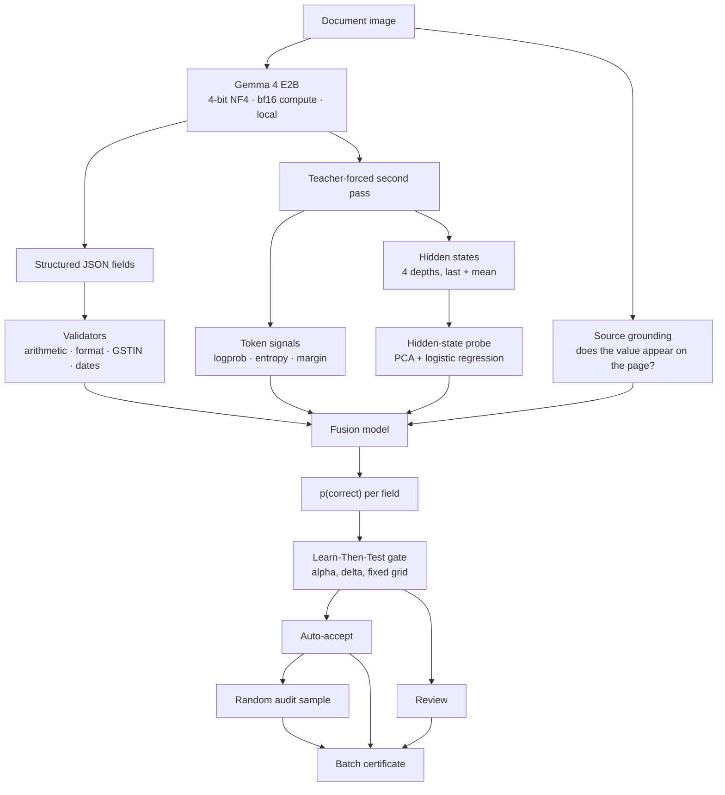
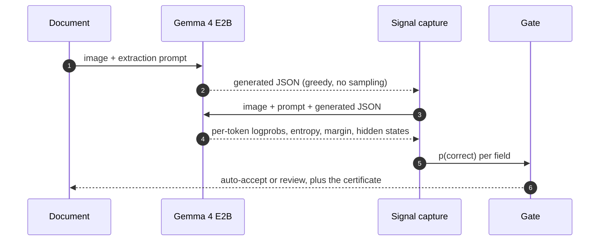
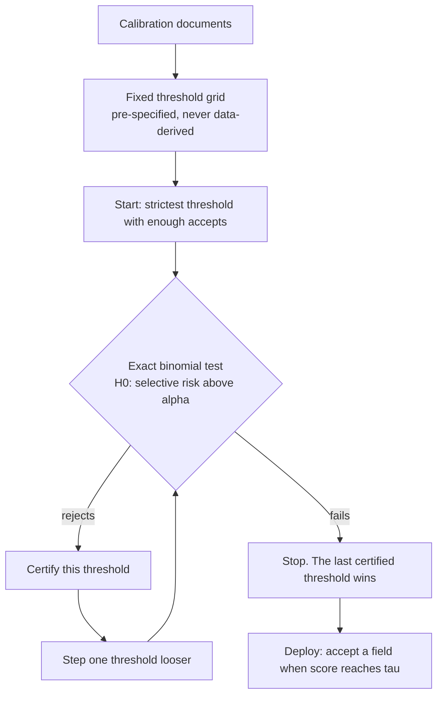
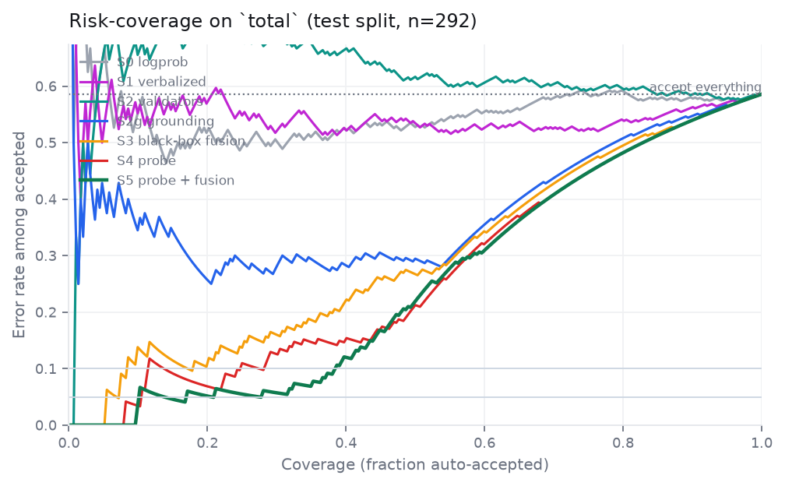
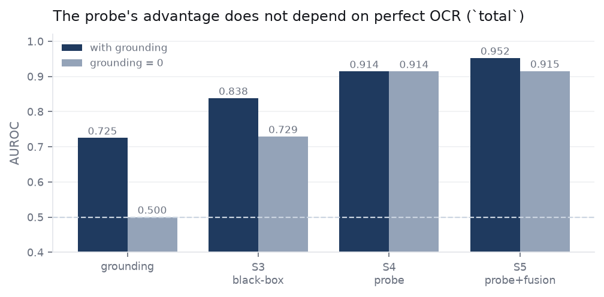
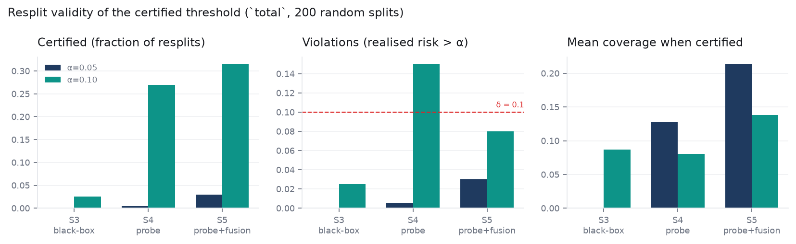
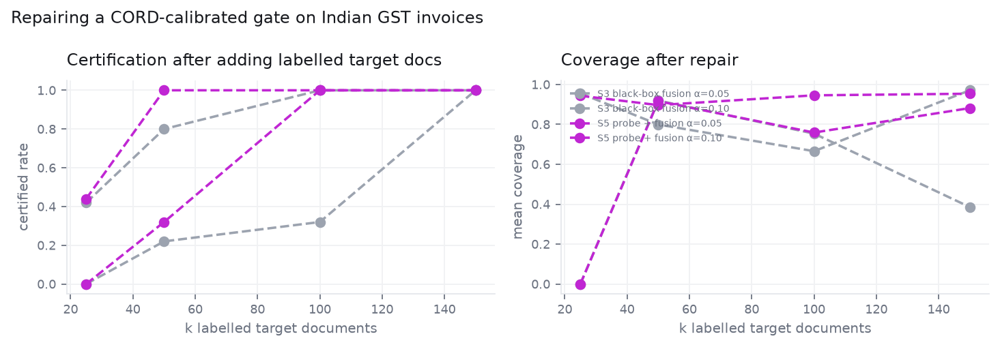
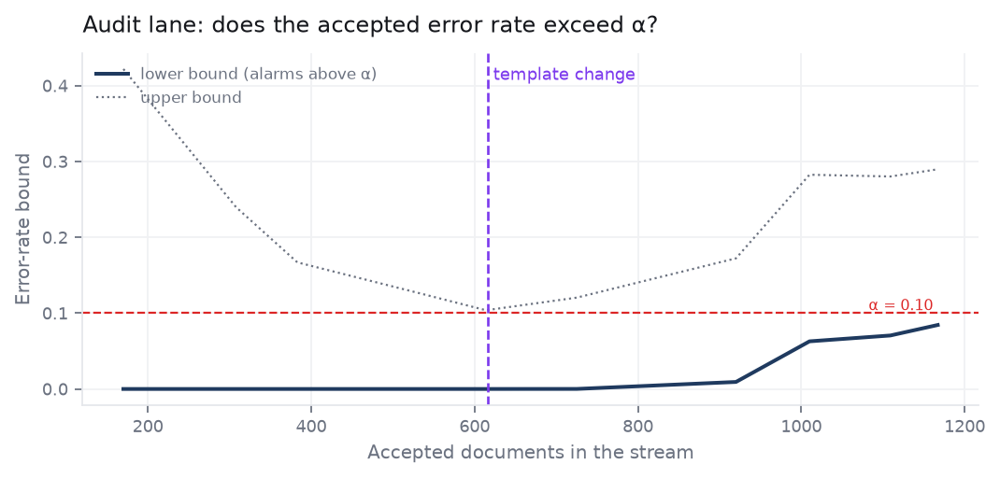

# Underwrite

**A local, open-weight invoice reader that ships a measured error guarantee instead of an accuracy claim.**

[](https://github.com/Krit-Jain/Underwrite/actions/workflows/ci.yml)


Every batch comes with a certificate:

> *"Error rate on documents like these: **≤ 10%** with **90% confidence**, measured across 200
> resplits of the calibration and test pools. **48.1%** of totals auto-processed, the rest routed
> to a human. Threshold set on 289 labelled documents. 12 auto-accepted fields sampled for
> audit."*

---

## Why this exists

A 2B vision-language model reads 972 CORD receipt totals correctly **58.6%** of the time. The
more interesting number is the other one: on the held-out test split, **92% of the 111 wrong
totals arrived with a mean token log-probability above −0.05** — an average per-token probability
above 0.95. It was certain, and it was wrong.

| | |
|---|---|
| the receipt's total | `8,800,000.00` |
| what the model returned | `88000.0` |
| its mean token log-probability | `−0.000002` |

*Document `cord_train_0137`; the sweep behind "92%" is `reports/tables/confident_errors.csv`.*

A bookkeeper cannot hand a client "about 96% accurate". They need to know **which values to
double-check**. So the deliverable here is not a parser — it is a decision: *auto-accept this
field, or flag it*, with the threshold chosen so the error rate among accepted fields stays under
a budget you pick.

## What it does

| | |
|---|---|
| **Reads** | receipts and invoices → `vendor`, `date`, `subtotal`, `tax`, `total` |
| **Runs** | locally, on a 6 GB laptop GPU, from pinned Apache-2.0 weights |
| **Decides** | auto-accept vs. review, per field, at a certified error budget |
| **Proves** | the budget with a Learn-Then-Test conformal gate plus a random audit lane |
| **Competes** | on privacy and *verifiability* — not on raw accuracy |

---

## Architecture



### The two passes

Generation gives you the answer and throws the uncertainty away. A second forward pass over the
*same* image, prompt and generated JSON recovers it.



### The gate

A threshold is only trustworthy if it was chosen without peeking. The gate is fixed-sequence
testing over a **grid decided in advance**: walk from the strictest threshold outward, test
`H0: selective risk > α` with an exact binomial test, and stop at the first failure.



Because the order is fixed and the walk stops at the first non-rejection, the family-wise error
rate is controlled: with probability ≥ 1 − δ the population selective risk is ≤ α, **provided new
documents are exchangeable with the calibration ones**. The audit lane exists because that
provision is the one that fails in practice.

---

## Results

Every number below is produced by a script in this repository and committed under
[`reports/tables/`](reports/tables). Figures live in [`reports/figures/`](reports/figures).

### Extraction

CORD, 983 documents, `google/gemma-4-E2B-it` (revision pinned), 4-bit NF4, RTX 4050 Laptop.

| | |
|---|---|
| throughput | **9.06 s/document** — 2.47 h for the corpus |
| memory | **6573 MB** peak VRAM |
| alignment | **983 / 983** value spans mapped to tokens |
| parse failures | 2 / 983 (logged, not hidden) |
| `total` accuracy | **58.6%** across 972 labelled documents |

### The ablation

**Empirical coverage, not certified coverage.** `total`, n = 292 held out, base error 38.0%. The
threshold behind each coverage column is selected on this same test set, so read the columns as an
achievable frontier rather than a promise; the certified numbers are under
[Is the certificate real?](#is-the-certificate-real).

| method | signal | AUROC | coverage @2% | @5% | @10% |
|---|---|---|---|---|---|
| **S0** | mean token log-probability | 0.632 | 1.0% | 1.0% | 1.0% |
| **S2** | validators only | 0.525 | 1.4% | 1.4% | 1.4% |
| **S2g** | source grounding | 0.725 | 0.3% | 0.3% | 0.3% |
| **S3** | logprob + validators + grounding | 0.838 | 8.2% | 14.7% | 46.2% |
| **S4** | hidden-state probe only | 0.914 | 17.5% | 30.5% | 51.7% |
| **S5** | **S3 + probe — the system** | **0.952** | **41.4%** | **49.7%** | **62.0%** |

**S4 is the result worth pausing on.** Nothing but a PCA and a logistic regression over the
model's internal vectors — no validators, no grounding, no token statistics — beats the entire
hand-built black-box stack (0.914 vs 0.838). A closed API does not expose those vectors at any
price.



### Does it depend on perfect OCR?

Grounding here uses CORD's ground-truth OCR words, which is optimistic. Removing it entirely makes
the comparison **stronger**, not weaker:

| | with grounding | grounding = 0 |
|---|---|---|
| S3 black-box fusion | 0.838 | **0.729** |
| S4 probe only | 0.914 | 0.914 |
| S5 probe + fusion | 0.952 | **0.915** |



### Is the certificate real?

200 random resplits of the pooled calibration + test documents. Each split calibrates on half and
measures the other half.

| α | method | certified | mean coverage | violations |
|---|---|---|---|---|
| 0.10 | S3 black-box | 39.5% | 10.9% | 8.0% |
| 0.10 | S5 probe + fusion | **100%** | **48.1%** | 11.5% |
| 0.05 | S3 black-box | 2.0% | — | 2.0% |
| 0.05 | S5 probe + fusion | **100%** | **29.4%** | 6.0% |

S5 certifies in **every** resplit; S3 almost never does. The one number that is not clean: **at
α=0.10 the violation rate is 11.5%, above δ=10%** — it is in the table rather than a footnote, and
explained under [Limitations](#limitations).



### What happens when the documents change

Calibrate on Indonesian receipts, deploy on synthetic Indian GST invoices:

| | source (CORD) | target (Indian GST) |
|---|---|---|
| coverage at α=0.10 | 42.9% | **2.5%** |
| realised risk | 5.6% | 0.0% |

The certificate does not break — it becomes **useless**. The scores shift even though the target
corpus is *easier* (90.5% of totals correct), so a threshold calibrated on hard documents is never
cleared. Recalibrating with labelled target documents repairs it:

> This table was re-run after the grounding-convention fix and came out **identical**: the collapse
> is a property of the score distribution, not an artifact of that bug.

| α | k = 25 | k = 50 | k = 100 |
|---|---|---|---|
| 0.10 | 76% certify, 93% coverage | **100%, 93%** | 100%, 94% |
| 0.05 | not certifiable | 70%, 91% | **100%, 92%** |

**Roughly 50 labelled documents per new client template to certify a 10% budget; about 100 for
5%.** That is a number a bookkeeper can act on.



### The audit lane

Flagged-item labels are selection-biased — humans only look at what the system already distrusts.
The audit lane samples a random slice of *auto-accepted* fields instead, and alarms when the
Clopper-Pearson **lower** bound on their error rate exceeds α, corrected for repeated looks. Over
500 seeds:

| true error rate | 2% | 4% | 6% | 8% |
|---|---|---|---|---|
| false alarms | 0.0% | 0.0% | 0.2% | 0.4% |

| audit rate | median detection delay | missed within 500 documents |
|---|---|---|
| 5% | 410 documents | 73% |
| 10% | 407 documents | 46% |
| 20% | 357 documents | 12% |

The alarm does not cry wolf. It is also **slow**: at a 10% audit rate roughly half of drifts go
unnoticed inside a short window. A quiet, slow monitor is useful; a noisy one gets switched off.



---

## Quickstart

```bash
python -m venv .venv
source .venv/bin/activate          # Windows: .venv\Scripts\activate
pip install -e ".[dev]"            # core + tests
pip install -e ".[ml]"             # the model harness, for GPU work
```

PyTorch is best installed from the [official selector](https://pytorch.org) for your CUDA build.
Gemma 4 is Apache-2.0 and **not gated** — no licence acceptance or token required. The revision is
pinned in `configs/default.yaml`, because a calibration is only valid against frozen weights.

**One document, end to end.** Synthesises a receipt if you don't pass `--image`:

```bash
python scripts/smoke_test.py
```

**The review UI.** Three lanes, an editable review list, and the certificate. It serves a
precomputed batch, so it needs no GPU:

```bash
uvicorn underwrite.app.server:app      # http://127.0.0.1:8000
```

**A batch with signals, no table** — one row per field, to inspect before committing to a run:

```bash
python scripts/dry_run.py --count 20
```

---

## Repository layout

```
underwrite/
├── configs/default.yaml       model id + pinned revision, seed, splits, alpha grid, delta
├── src/underwrite/
│   ├── config.py              validated configuration (dataclasses, no magic strings)
│   ├── extract/               prompts · tolerant JSON parser · harness · teacher forcing
│   ├── signals/               token stats · validators · GSTIN · grounding · verbalized
│   ├── probe/                 feature bundles · hidden-state probe · S0-S5 scorers
│   ├── conformal/             Learn-Then-Test gate · audit lane
│   ├── eval/                  risk-coverage · resplit validity · shift + repair
│   ├── app/                   review UI · certificate
│   └── data/                  CORD loader · synthetic GST generator · splits · normalization
├── scripts/                   one script per experiment (table below)
├── tests/                     293 CPU-only tests, no model weights needed
└── reports/                   committed tables and figures — every number in this README
```

| script | produces |
|---|---|
| `smoke_test.py` | one extraction: JSON, seconds, peak VRAM |
| `generate_synth.py` | synthetic Indian GST invoices + ground truth |
| `run_extraction.py` | resumable extraction and signal capture (`.npz` per document) |
| `build_features.py` | the flat feature table |
| `run_experiments.py` | the S0–S5 ablation (`--no-grounding` for the OCR-free variant) |
| `run_validity.py` | 200-resplit validity |
| `run_shift.py` | shift and repair-vs-k |
| `run_audit_detection.py` | false-alarm rate and detection delay over 500 seeds |
| `build_demo_batch.py` | the frozen batch the review UI serves |
| `make_figures.py` | every figure in `reports/figures/` |

## Development

```bash
pytest          # 293 tests, CPU only, no model weights
```

The GPU smoke test is deliberately a separate script so the suite stays runnable anywhere.

## Correctness definition

| field | definition |
|---|---|
| money | `Decimal` equality at 2 dp after stripping symbols and separators |
| date | parsed ISO 8601 equality |
| vendor | `rapidfuzz` ratio ≥ 90 after normalization |
| parse failure | counts as an error, never as a skip |

---

## Limitations

Read this before quoting any number above.

- **The certificate covers `total` only.** One value per document means independent calibration
  samples. A per-field guarantee on the other fields would be invalid — a document's fields are
  correlated, which is exactly the failure mode in
  [arXiv:2608.14639](https://arxiv.org/html/2608.14639v1).
- **Grounding uses oracle page text.** CORD's ground-truth OCR and the synthetic renderer's own
  text stand in for a real OCR pass, so absolute coverage is optimistic. The `--no-grounding`
  ablation shows the S3-vs-S5 comparison does not depend on it.
- **S1 is absent from the current table.** The final run skipped the self-rating call to halve the
  runtime; S1 was measured on an earlier run at AUROC 0.603.
- **~290 calibration documents is thin.** α=0.05 sits at the edge, and the α=0.10 violation rate
  over resplits (11.5%) is slightly above δ=10%. Part of that is finite-test-set noise — the
  guarantee bounds *population* risk, and realised risk on a few hundred documents fluctuates
  across the boundary — but it is above the line.
- **The audit lane is slow, not noisy.** At a 10% audit rate, 46% of 40% drifts go undetected
  within 500 documents.
- **A 2B model on a 6 GB card sets the ceiling.** Base error is 38% on `total`; a larger model
  would raise coverage, it would not change the machinery.
- **Exchangeability is assumed.** The audit lane exists because that assumption can fail.
- CORD is Indonesian (CC-BY-4.0) and annotates no vendor or date, so the five-field story is
  necessarily a three-field one on that corpus.

## Prior work

This builds directly on open work and claims no novelty for the machinery:

| work | what this project takes from it |
|---|---|
| [Learn-Then-Test](https://arxiv.org/abs/2110.01052) (Angelopoulos et al.) | fixed-sequence threshold calibration |
| [VerifyDoc](https://github.com/bhaskargurram-ai/verifydoc) (Apache-2.0) | per-field confidence, grounding, and accept/review at a target selective risk; its CORD AUROCs are why grounding is in the baseline |
| [arXiv:2608.14639](https://arxiv.org/html/2608.14639v1) | why the naive per-field procedure violates its own guarantee — the reason the certificate here is restricted to `total` |
| [CORD](https://huggingface.co/datasets/naver-clova-ix/cord-v2) (Park et al.) | the real-receipt corpus |
| [Gemma 4](https://deepmind.google/models/gemma/gemma-4/) (Google DeepMind) | the extractor |

The narrow contribution: at a *matched certified error rate* on a laptop-class open model, a
hidden-state probe auto-processes substantially more documents than a strong black-box stack that
already includes grounding.

## License

MIT — see [LICENSE](LICENSE).
